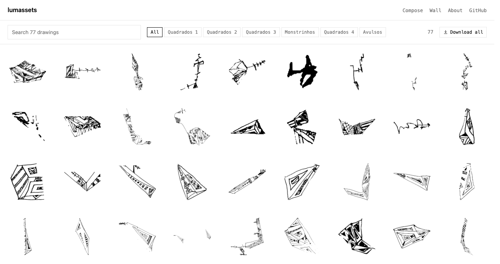
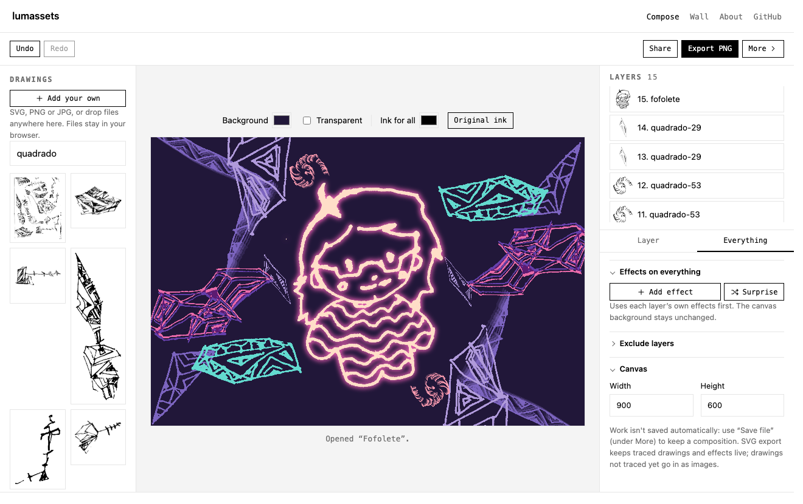

# lumassets

lumassets is a set of drawings-turned-assets by [Luma Montes][luma], a side project for spending more time with creative stuff while also doing some coding.

Each drawing can be copied, recolored, or downloaded as SVG or PNG, one at a time or all at once as a ZIP. [Browse the drawings][library].

[][library]

There’s also a [composer][compose] where you can pick drawings, play with effects, and export what you make. You can bring your own images, too. Keep the photo as it is, remove the paper from a scan, or pick a background color to clear. Make something weird!

[][compose]

[quick-editor][quick-editor] turns photos of drawings into clean, transparent SVGs. The [asset guide](docs/adding-assets.md) shows how to add them to the library.

[Contact][contact] · [Report a bug][issues]

## The Wall

[The Wall][wall] is where people share things they’ve made in the composer. To put something up, click **Share** in Compose. It’ll appear once it’s approved.

Open a post to copy its link or choose **Remix** to bring it into the composer and make your own version.

## Technology

- **Astro and TypeScript** for the static site.
- **Fabric.js** for the composer and **Sharp** for generating the library’s preview images at build time.
- **Cloudflare Workers** serves the site and wall API. The wall uses **R2** for images, **D1** for posts, and **Turnstile** on the share form.

## Run it locally

With Node and pnpm installed:

```sh
nvm use
pnpm install --frozen-lockfile
pnpm dev
```

For the full check, install Chromium with `pnpm exec playwright install chromium`, then run `pnpm verify`. See [deployment](docs/cloudflare-workers.md) and [wall setup](docs/wall.md) for the Cloudflare side.

## License

- Drawings are [CC0](LICENSE-ASSETS.md). Use them for anything, no credit needed.
- The code is [MIT](LICENSE).

[luma]: https://lumamontes.com
[library]: https://lumassets.bibliotecadezines.workers.dev/
[compose]: https://lumassets.bibliotecadezines.workers.dev/compose/
[wall]: https://lumassets.bibliotecadezines.workers.dev/wall/
[quick-editor]: https://github.com/lumamontes/quick-editor
[contact]: https://lumamontes.com/br/contact
[issues]: https://github.com/lumamontes/lumassets/issues
